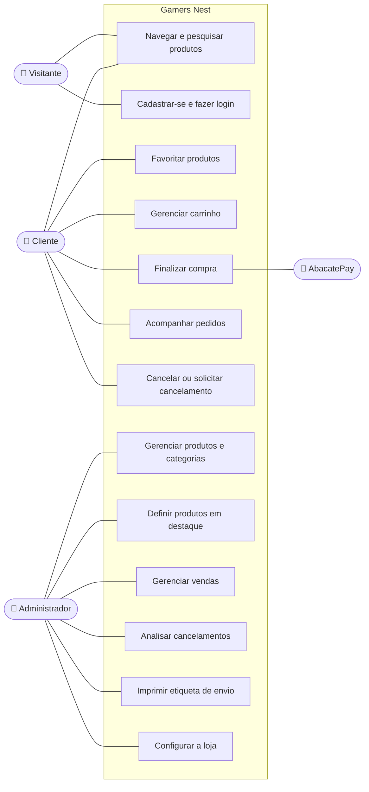
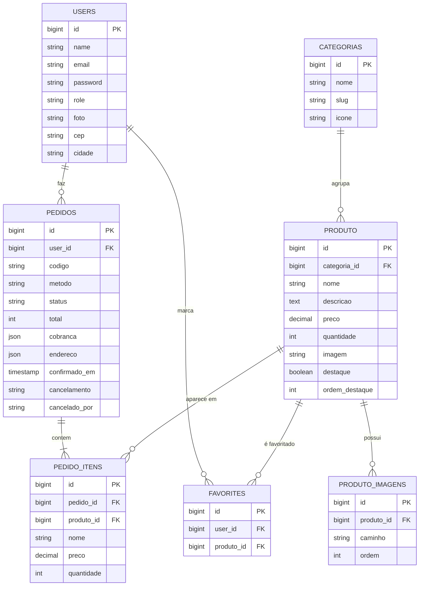
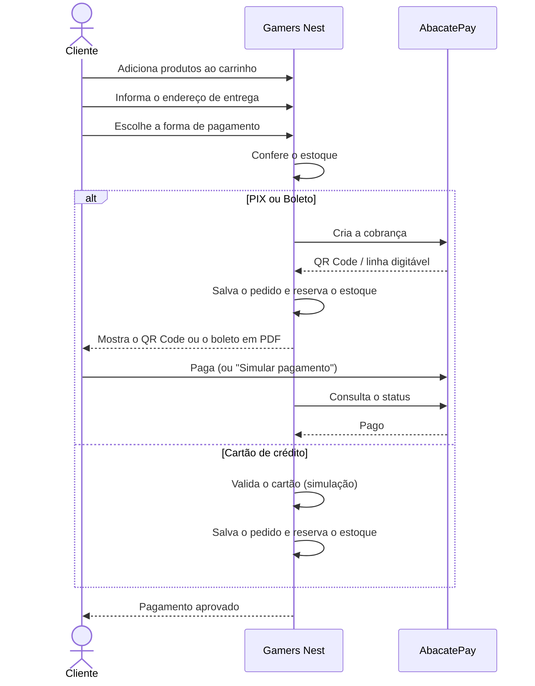
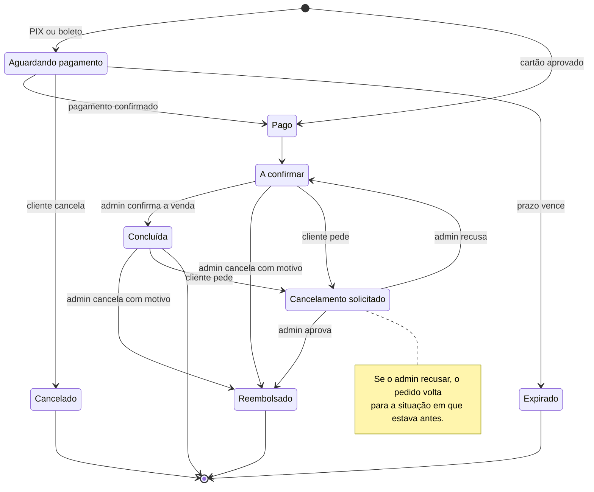

# Gamers Nest

## Descrição

Projeto de TCC do curso de Engenharia de Software (Uniguairacá). É uma loja virtual de jogos e consoles feita em Laravel, com catálogo, carrinho, pagamento e uma área de administração para cuidar dos produtos e das vendas.

Os pagamentos usam o ambiente de testes do AbacatePay, então nenhuma compra é real.

## Problema

- Muitas lojas pequenas do ramo gamer vendem só por redes sociais ou WhatsApp.
- O pedido é anotado na mão e o pagamento é confirmado manualmente.
- Isso gera demora, erro em pedido e dificuldade para controlar o que foi vendido.
- Para o cliente, falta um lugar organizado para ver os produtos e comprar sem precisar ficar conversando com o vendedor.

## Justificativa

- Com uma loja própria, a venda não depende de marketplace nem de atendimento manual.
- O pagamento por PIX e boleto já fica integrado na finalização do pedido.
- O lojista tem os pedidos e os produtos organizados em um painel.
- O cliente compra a qualquer hora, de forma mais rápida e segura.

## Tecnologias Utilizadas

| Camada | Tecnologia |
|---|---|
| Back-end e Front-end | PHP, Laravel |
| Gerenciador de dependências | Composer |
| Estilização | Tailwind CSS |
| Banco de Dados | MySQL (via XAMPP) |
| Servidor Local | Apache (via XAMPP) |
| Pagamentos | AbacatePay (modo de teste) |

## Regras de Negócio

**Acesso**
- Qualquer pessoa pode ver o catálogo, pesquisar e abrir os produtos, mas para favoritar, usar o carrinho e comprar é preciso estar logado.
- Só usuários com o perfil `admin` acessam o cadastro de produtos e categorias, os destaques, as vendas e as configurações da loja.

**Produtos e estoque**
- Todo produto pertence a uma categoria e precisa ter nome, preço, estoque e pelo menos uma foto.
- Um produto pode ter no máximo 5 fotos de até 2 MB cada. A primeira é a capa usada no catálogo.
- Não existem duas categorias com o mesmo nome.
- No máximo 10 produtos podem ficar em destaque. Eles aparecem primeiro na tela inicial, na ordem definida pelo admin.
- Não é possível colocar no carrinho mais unidades do que o estoque disponível, e produto com estoque zerado não pode ser adicionado.
- O estoque é descontado quando o pedido é criado e devolvido se o pedido for cancelado, reembolsado ou expirar.

**Compra e pagamento**
- Para finalizar a compra é obrigatório informar o endereço de entrega (CEP, logradouro, número, bairro e cidade), nome, CPF válido e celular.
- O estoque é conferido de novo na finalização. Se algum item não tiver mais a quantidade pedida, a compra é bloqueada.
- O valor mínimo de uma compra é R$ 1,00.
- O PIX vale 1 hora e o boleto vence em 3 dias. Depois disso, ao clicar em "Pagar", uma nova cobrança é gerada.
- O cartão de crédito é validado no próprio sistema (número, validade e CVV) e pode ser parcelado em até 12 vezes, com parcela mínima de R$ 10,00. Os dados do cartão não são salvos.
- O admin pode desativar formas de pagamento nas configurações da loja.

**Pedidos e cancelamentos**
- Todo pedido pago fica "A confirmar" até o admin confirmar a venda, quando passa para "Concluída".
- O cliente pode cancelar sozinho apenas pedidos que ainda aguardam pagamento.
- Para pedidos já pagos, o cliente só pode solicitar o cancelamento (uma vez por pedido), e o admin aprova ou recusa.
- O admin pode cancelar uma venda paga a qualquer momento, desde que informe o motivo. O pedido fica como "Reembolsado".
- Todo cancelamento registra quem cancelou (cliente, loja ou sistema), o nome da pessoa e a data.
- Pedidos reembolsados ou cancelados não entram no faturamento.

## Casos de Uso

| Caso de uso | Ator | Descrição |
|---|---|---|
| Navegar e pesquisar produtos | Visitante, Cliente | Ver o catálogo, filtrar por categoria, pesquisar e abrir a página do produto. |
| Cadastrar-se e fazer login | Visitante | Criar uma conta e entrar no sistema. |
| Favoritar produtos | Cliente | Marcar e desmarcar produtos como favoritos. |
| Gerenciar carrinho | Cliente | Adicionar, aumentar, diminuir e remover produtos do carrinho. |
| Finalizar compra | Cliente, AbacatePay | Informar endereço e dados, escolher PIX, boleto ou cartão e pagar. |
| Acompanhar pedidos | Cliente | Ver as compras em "Minhas Compras" e pagar pedidos pendentes. |
| Cancelar ou solicitar cancelamento | Cliente | Cancelar pedido não pago ou pedir o cancelamento de um pedido pago. |
| Gerenciar produtos e categorias | Administrador | Cadastrar, editar e excluir produtos (com fotos) e categorias. |
| Definir produtos em destaque | Administrador | Escolher e ordenar os produtos que aparecem primeiro na loja. |
| Gerenciar vendas | Administrador | Ver as vendas por situação, confirmar vendas e cancelar com motivo. |
| Analisar cancelamentos | Administrador | Aprovar ou recusar os cancelamentos pedidos pelos clientes. |
| Imprimir etiqueta de envio | Administrador | Gerar a etiqueta com destinatário, remetente e conteúdo do pedido. |
| Configurar a loja | Administrador | Trocar logo, banners e formas de pagamento ativas. |

## Diagramas

### Diagrama de casos de uso



### Diagrama do banco de dados



### Fluxo da compra



### Situações de um pedido



## Como Executar o Projeto

Precisa ter o XAMPP (PHP 8.2+), o Composer e o Node.js instalados. Também é preciso ativar a extensão GD do PHP, senão o PDF do boleto não funciona (no `php.ini`, tirar o `;` da linha `extension=gd`).

1. No XAMPP, ligar o Apache e o MySQL e criar no phpMyAdmin um banco chamado `laravel`.

2. Na pasta do projeto:

```bash
composer install
npm install
cp .env.example .env
php artisan key:generate
```

3. No `.env`, conferir os dados do banco e colocar a chave de teste do AbacatePay:

```env
DB_DATABASE=laravel
DB_USERNAME=root
DB_PASSWORD=

ABACATEPAY_API_KEY=sua_chave_de_teste
```

4. Criar as tabelas e as categorias:

```bash
php artisan migrate
php artisan db:seed --class=CategoriaSeeder
```

5. Rodar em dois terminais:

```bash
php artisan serve
npm run dev
```

O site abre em http://127.0.0.1:8000.

Para ter um usuário administrador, é só se cadastrar pelo site e depois mudar o campo `role` dele para `admin` na tabela `users`.

## Testando os pagamentos

- CPF para teste: 529.982.247-25
- Cartão aprovado: 4242 4242 4242 4242 (qualquer validade futura e qualquer CVV)
- Cartão recusado: 4000 0000 0000 0002
- No PIX e no boleto tem um botão "Simular pagamento" na tela do pedido

## Estrutura

```
TCC Games Nest
┣ 📂 app
┃ ┣ 📂 Http
┃ ┃ ┣ 📂 Controllers   → Produtos, categorias, carrinho, checkout, pedidos e perfil
┃ ┃ ┣ 📂 Middleware    → Controle de acesso do administrador
┃ ┃ ┗ 📂 Requests      → Validação de login e perfil
┃ ┗ 📂 Models          → Produto, Categoria, Pedido, PedidoItem, ProdutoImagem, User
┣ 📂 database
┃ ┣ 📂 migrations      → Estrutura das tabelas
┃ ┗ 📂 seeders         → Categorias iniciais
┣ 📂 resources/views   → Telas (Blade)
┣ 📂 routes            → Rotas da aplicação (web.php)
┗ 📜 composer.json
```

## Funcionalidades Desenvolvidas

Parte do cliente:
- ver os produtos por categoria e pesquisar (se não achar o jogo, mostra produtos parecidos)
- ver o produto com até 5 fotos
- salvar favoritos
- carrinho, respeitando o estoque
- pagar com PIX, boleto ou cartão (o cartão é só uma simulação, não passa pelo AbacatePay)
- ver as compras em "Minhas Compras", pagar um pedido pendente, cancelar ou pedir o cancelamento de um pedido já pago

Parte do administrador:
- cadastrar e editar produtos e categorias
- escolher quais produtos aparecem primeiro na tela inicial (destaques)
- o estoque diminui quando alguém compra e volta quando o pedido é cancelado
- tela de vendas separada em: a confirmar, concluídas, cancelamento solicitado, canceladas e aguardando pagamento
- confirmar uma venda, cancelar com motivo e aprovar ou recusar os cancelamentos pedidos pelos clientes
- imprimir a etiqueta de envio do pedido
- trocar o logo, os banners e as formas de pagamento da loja

## Sobre o Projeto

O Gamers Nest é um e-commerce voltado para a venda de jogos, consoles e acessórios. Foi desenvolvido com PHP e Laravel como Trabalho de Conclusão de Curso de Engenharia de Software no Centro Universitário Guairacá (Uniguairacá), com o objetivo de facilitar a compra desses produtos e dar ao lojista uma forma simples de controlar o catálogo, o estoque e as vendas.
